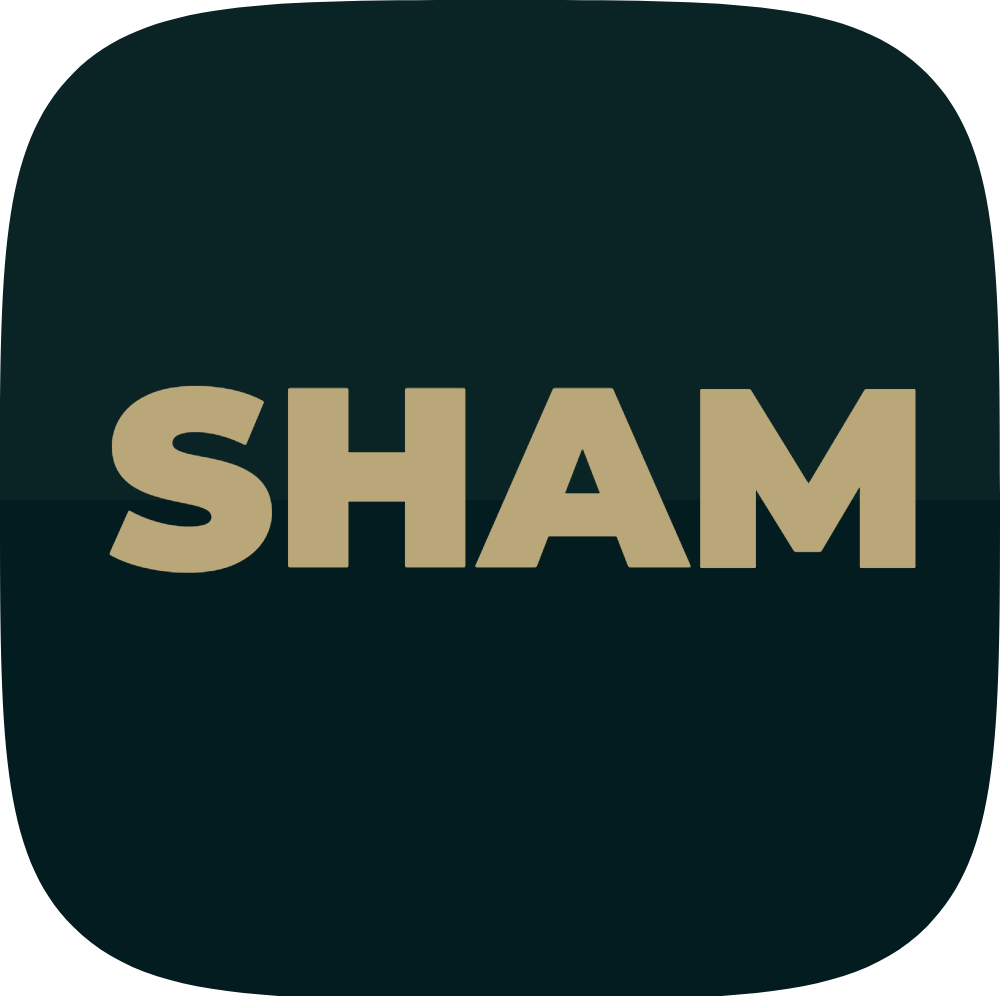
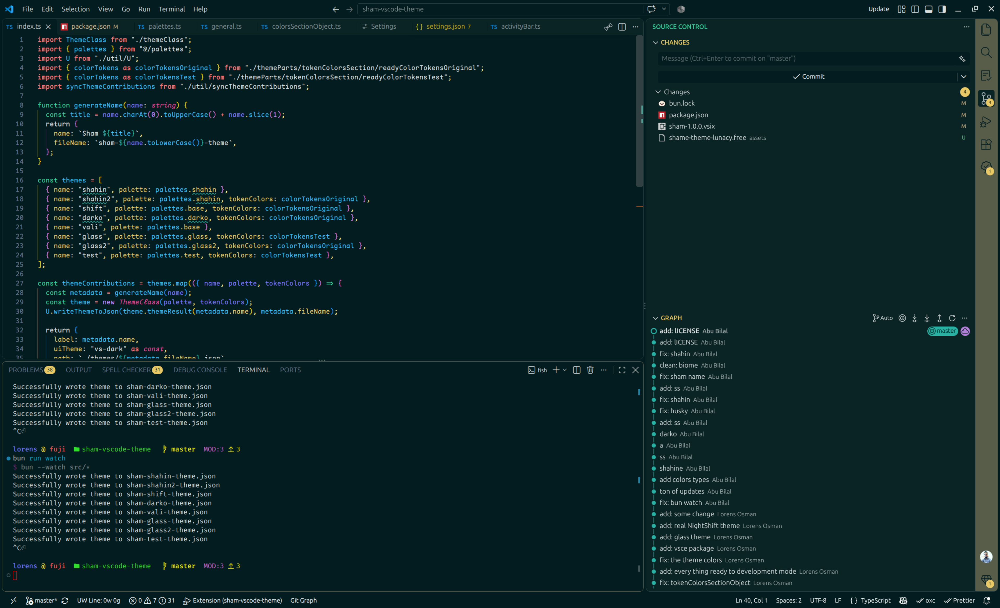

<h1 align="center">SHAM</h1>
<h3 align="center">A VS Code theme inspired by Syrian new colors</h3><br>

<p align="center">  </p>

Seven variants, one philosophy: low-contrast comfort, vibrant-but-soft accents,
and code that stays readable at 2 a.m.

[](https://marketplace.visualstudio.com/items?itemName=lorensosman.sham)
[](https://code.visualstudio.com)
[](LICENSE)
[](#-themes)

<br />

<p align="left">  </p>

<br />

</div>

## ✨ Highlights

- 🎨 **Palette-driven** — every theme is generated from a single color palette; change one hex value and the whole UI follows.
- 🔤 **One grammar, tokenColor sets** — original and test token styles share the same well-organized color sections (editor, sidebar, terminal, git decorations…).
- 🍃 **Calm by default** — muted backgrounds (`#111827`, `#0e151a`…) with carefully chosen accents.
- 🛠 **Typed & autocomplete-friendly** — only real VS Code color keys are allowed, thanks to a generated key list.

## 🎨 Themes

| Theme            | Vibe                   | Background | Accent    |
| ---------------- | ---------------------- | ---------- | --------- |
| **Sham Shahin**  | deep teal & gold       | `#031c1f`  | `#fde68a` |
| **Sham Shahin2** | Shahin, classic tokens | `#031c1f`  | `#fde68a` |
| **Sham Shift**   | slate night            | `#111827`  | `#57a7e6` |
| **Sham Darko**   | near-black & soft      | `#0e151a`  | `#05b7b0` |
| **Sham Vali**    | clean slate            | `#111827`  | `#57a7e6` |
| **Sham Glass**   | muted & glassy         | `#161b21`  | `#4a78b4` |
| **Sham Glass2**  | softer glass tone      | `#161b21`  | `#38bdf8` |

> All themes ship as `vs-dark`.

## 📦 Install

### One-line install (script)

```bash
curl -fsSL https://raw.githubusercontent.com/lorens-osman-dev/sham-vscode-theme/master/scripts/downloadAndInstall.sh | bash
```

> 🚀 Releases are automated: pushing a version tag (`git tag v1.2.3 && git push origin v1.2.3`)
> makes [GitHub Actions](.github/workflows/release.yml) build the theme, package the
> `.vsix`, verify the tag matches `package.json`, and attach it to a GitHub release —
> which is what the script above downloads.

### Install manually

Grab the latest `.vsix` from the
[releases page](https://github.com/lorens-osman-dev/sham-vscode-theme/releases),
then use option A or B .

- **Option A — the command line:**

  ```bash
  code --install-extension sham-1.0.0.vsix
  ```

- **Option B — from inside VS Code:**

  1. Open the **Extensions** view (`Ctrl+Shift+X` / `⌘+Shift+X`).
  2. Click the **⋯** (more actions) menu in the top-right of the panel.
  3. Choose **Install from VSIX…**
  4. Browse to the downloaded `sham-1.0.0.vsix` and confirm.

## 🛠 Development

> 📘 Full guide in **[DEVELOPMENT.md](DEVELOPMENT.md)** — including a
> command-by-command walkthrough from "I made a change" all the way
> to _release + Marketplace publish_, plus troubleshooting.

Quick reference:

- 🎨 Edit palettes in [`src/palettes.ts`](src/palettes.ts) — keep `bun run watch` running and it regenerates `themes/*.json` + `package.json` for you.
- 🔍 Preview in a debug instance: open the **Run and Debug** panel → `F5`.
- ✅ Type check before committing: `bun run check` (also `bun run update-color-keys` when the VS Code engine version changes).
- 🏷 Release flow: `npm version patch|minor` → `git push origin master --follow-tags` → GitHub Actions creates the GitHub release.
- 🔑 Marketplace publish: automatic with the `VSCE_PAT` secret, or manually via `npx vsce publish`.

## 📝 License

[MIT](LICENSE) © lorensosman
